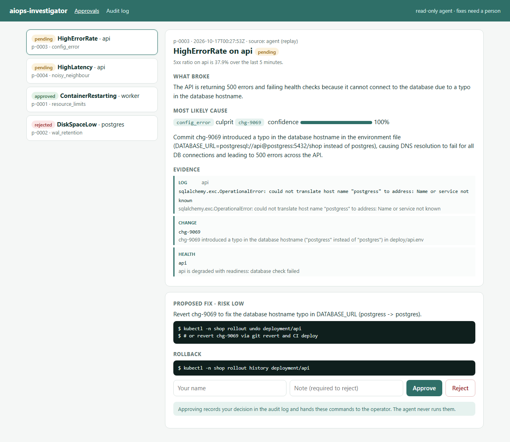
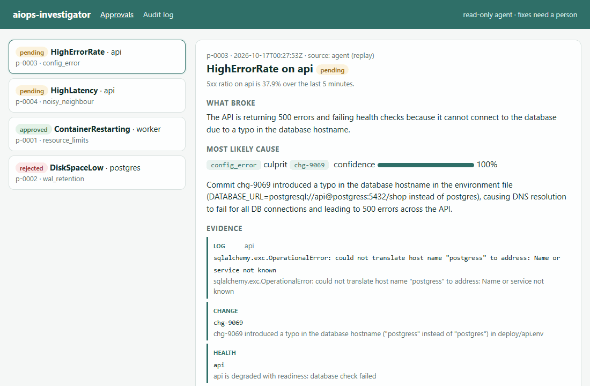
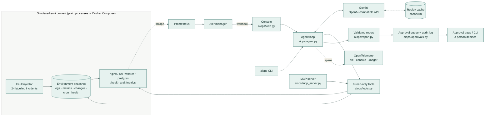
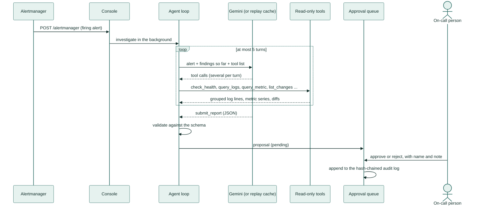
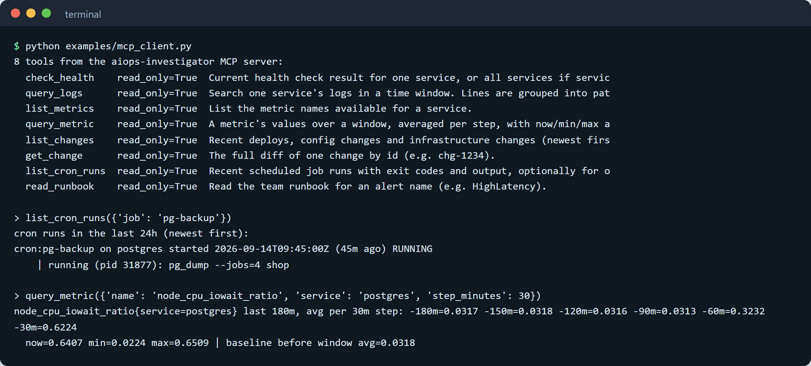
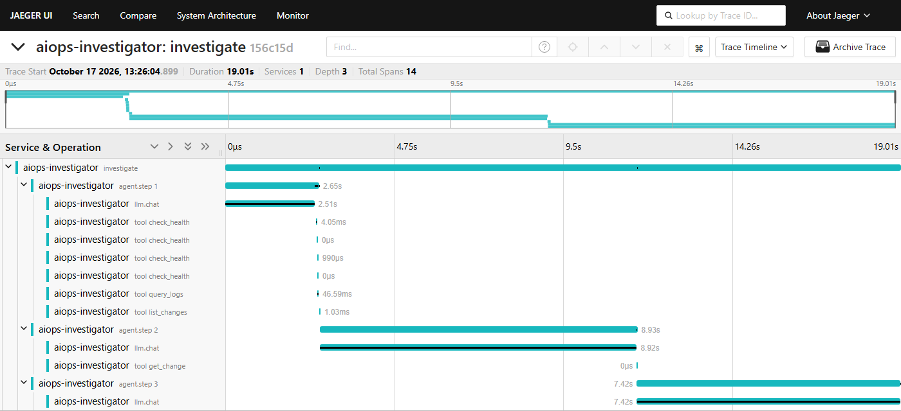
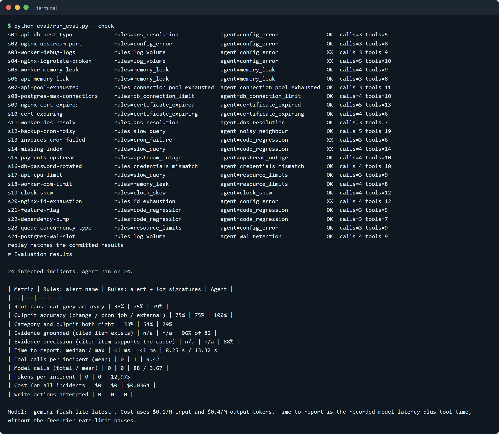
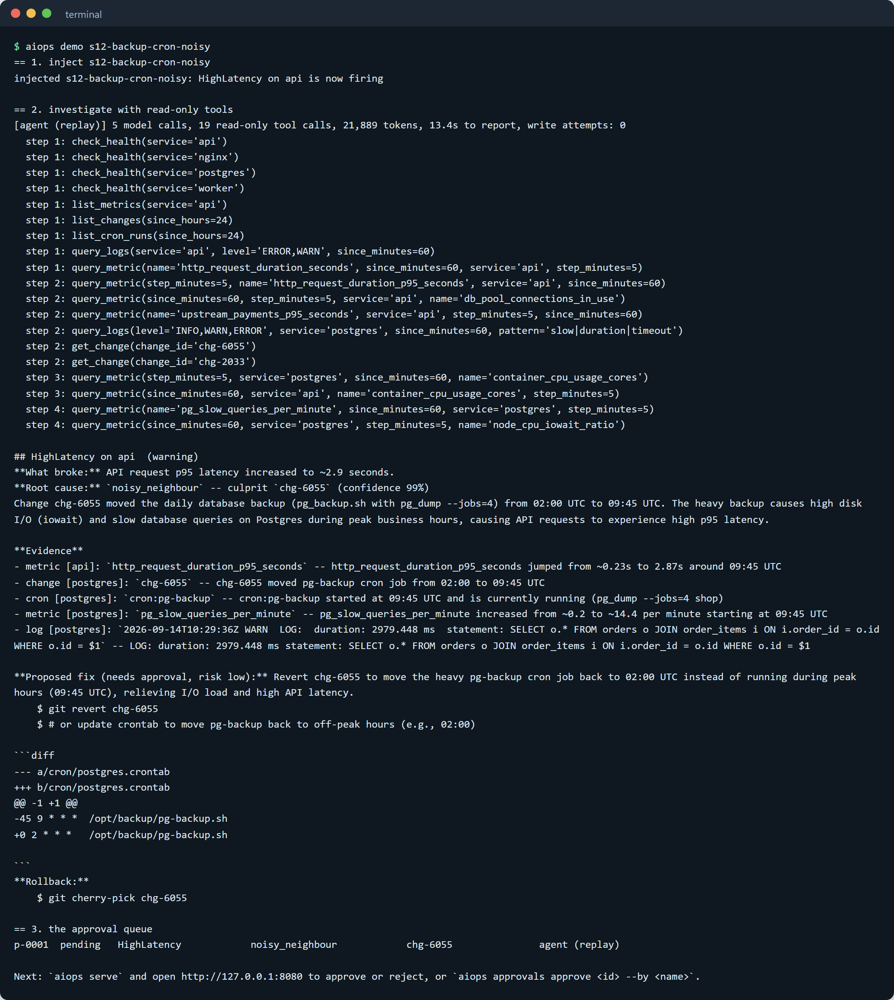

# aiops-investigator

**An AI on-call engineer.** When a monitoring alert fires, it investigates with read-only tools and writes an
incident report with evidence and a proposed fix. A person approves or rejects the fix. It never changes anything
itself.

[](https://github.com/samiulhuda360/aiops-investigator/actions/workflows/ci.yml)


## What it does

When something breaks in a web service at 3 am, an alert wakes someone up, and they spend the next half hour
digging through logs, graphs and the list of recent changes to work out why. This tool does that digging for them.
It reads everything it needs, explains what broke and why, shows the exact lines and numbers that prove it, and
suggests a fix with an undo plan. The person on call only has to check the reasoning and press Approve or Reject.

## A real-life example

**Megan runs on-call for Acme Outdoor, an online shop** with a small team of four engineers.

- **Before:** at 10:15 on a Monday the "site is slow" alert fires. Megan opens five tabs: the latency graph, the
  database dashboard, the logs, the deploy history and the cron schedule. Thirty-five minutes later she finds it: a
  colleague moved the nightly database backup to 09:45 the day before, and it is now hogging the disk during
  business hours.
- **With aiops-investigator:** the alert arrives and, about 13 seconds later, a report is waiting. It says the
  backup job is starving the database, quotes the slow-query log line, shows disk wait jumping from 3% to 62% at
  09:45, and names the exact change that moved the backup. It proposes moving the job back to 02:00, with the
  command to undo that.
- **After:** Megan reads the report, agrees, types her name and clicks Approve. The decision is logged. The whole
  thing takes about five minutes instead of thirty-five, and nothing ran without her say-so.

## How you would use it

1. Point your monitoring system's alerts at it. It accepts the same alert messages that Prometheus Alertmanager
   sends, so this is one line of configuration.
2. When an alert fires, open the approvals page in your browser. A new report appears for that alert.
3. Read the report: what broke, the most likely cause, how sure it is, and the evidence it found.
4. Look at the proposed fix and the undo plan.
5. Type your name and click **Approve**, or add a reason and click **Reject**. Either way it is written to the
   audit log.
6. If you approved, run the commands it shows (or hand them to whoever runs changes). The tool itself never runs them.


*The approval page. The agent traced a burst of server errors to a one-letter typo in a database hostname,
quoted the log line that proves it, and is waiting for a person to approve the rollback.*


*A recorded session: Megan opens the "site is slow" report, scrolls through the evidence and fix, approves it,
and checks the audit log.*

## Results at a glance

On 24 planted incidents, each with a known true cause (details in [Evaluation](#evaluation)):

| | Rules: alert name | Rules: alert + log signatures | **Agent** |
|---|---|---|---|
| Right kind of cause | 38% | 75% | **79%** |
| Right culprit (the change, job or third party to blame) | 75% | 75% | **100%** |
| Both right | 33% | 54% | **79%** |
| Cited evidence that actually supports the cause | n/a | n/a | **88%** of 82 items |
| Write actions attempted | 0 | 0 | **0** |

---

## How it works

1. **An alert arrives** at `POST /alertmanager` (the standard Alertmanager webhook format) or from
   `aiops investigate` on the command line.
2. **The agent loop starts** (`aiops/agent.py`). A tool-calling model (Gemini, through its OpenAI-compatible API)
   gets the alert, a list of root-cause categories and nine tools: eight read-only investigation tools and one
   `submit_report` tool.
3. **It investigates** for at most five turns. Each turn it may call several tools at once: check health, search
   logs, read metrics, list recent changes and read their diffs, read cron job history, read a runbook.
4. **Every tool is read-only** (`aiops/tools.py`). They read files or call `/health` endpoints. There is no tool
   that writes, restarts or runs a command, and any other tool name the model invents is refused and counted.
5. **It submits a report** that must match a JSON schema (`aiops/report.py`): what broke, the cause category,
   the culprit, a confidence, the evidence, and a fix with commands, an optional config diff and a rollback. A report
   that does not validate is sent back to the model to fix. On the last turn only `submit_report` is offered.
6. **The fix goes to the approval queue** (`aiops/approvals.py`). A named person approves or rejects it on the web
   page or the command line. Every event is appended to a hash-chained audit log, so an edited line is detected.
7. **Every step is traced** with OpenTelemetry (`aiops/telemetry.py`): one span per investigation, per agent step,
   per model call (with token counts) and per tool call (with its arguments).

### Architecture



### The main flow



## The simulated environment

A small online shop: **Nginx** in front of an **API**, a background **worker**, and **Postgres**. Each incident is a
six-hour snapshot of that shop (`aiops/sim/`):

- **Logs**: one file per service, with normal traffic, harmless warnings and the lines the fault produces.
- **Metrics**: 34 Prometheus-style series (23 metric names) at one-minute resolution (error ratio, p95 latency, memory against its
  limit, CPU throttling, disk use, DB pool use, Postgres connections, WAL size, certificate expiry, clock offset...).
- **Change history**: deploys, config changes and infrastructure changes, each with a diff. Every snapshot also has
  two or three harmless changes as red herrings.
- **Cron history**: logrotate, backups, certificate renewal and invoicing, with exit codes and output.
- **Health checks** per service.

The **fault injector** (`aiops/sim/scenarios.py`) plants one of 24 incidents into a healthy background. Each has a
labelled root cause that only the evaluator sees. Generation is deterministic: the same incident always gives
byte-identical files, which is what makes replaying model runs possible.

| # | Incident | Alert that fires | True cause |
|---|---|---|---|
| 1 | Database hostname typo in a deploy | HighErrorRate (api) | config_error |
| 2 | Nginx upstream pointed at the wrong port | HighErrorRate (nginx) | config_error |
| 3 | Debug logging left on, disk filling | DiskSpaceLow (worker) | log_volume |
| 4 | Typo in logrotate config, rotation failing | DiskSpaceLow (nginx) | log_volume |
| 5 | Unbounded in-process cache, OOM kill | ContainerRestarting (worker) | memory_leak |
| 6 | PDF renderers never closed | HighMemoryUsage (api) | memory_leak |
| 7 | Report export holds DB connections open | HighLatency (api) | connection_pool_exhausted |
| 8 | Worker concurrency raised 8 to 64 | HighErrorRate (api) | db_connection_limit |
| 9 | Certificate renewal failing after a DNS move, cert expired | ProbeFailed (nginx) | certificate_expired |
| 10 | Hand-installed certificate not covered by renewal | CertificateExpiringSoon (nginx) | certificate_expiring |
| 11 | Node image with a wrong DNS resolver | JobFailureRateHigh (worker) | dns_resolution |
| 12 | Database backup moved into business hours | HighLatency (api) | noisy_neighbour |
| 13 | Nightly invoice job crashes on a new field | CronJobFailed (worker) | cron_failure |
| 14 | Migration dropped an index | HighLatency (api) | slow_query |
| 15 | Payment provider timing out | HighLatency (api) | upstream_outage |
| 16 | Database password rotated, worker not restarted | QueueBacklogHigh (worker) | credentials_mismatch |
| 17 | CPU limit cut from 2 cores to 0.5 | HighLatency (api) | resource_limits |
| 18 | Memory limit cut from 2 GiB to 512 MiB | ContainerRestarting (worker) | resource_limits |
| 19 | Time sync removed from the base image | HighErrorRate (api) | clock_skew |
| 20 | Nginx file-descriptor limit removed | HighErrorRate (nginx) | fd_exhaustion |
| 21 | Feature flag rolled to 100% with a bug | HighErrorRate (api) | code_regression |
| 22 | Library upgrade removed a constant | JobFailureRateHigh (worker) | code_regression |
| 23 | Worker concurrency set to 1 by mistake | QueueBacklogHigh (worker) | config_error |
| 24 | Inactive replication slot holding WAL | DiskSpaceLow (postgres) | wal_retention |

The alerts are deliberately ambiguous. `HighLatency` on the API has five different causes in the set, and
`ContainerRestarting` on the worker is a memory leak once and a lowered memory limit once. You cannot get these
right from the alert name alone.

## Read-only tools and the MCP server

| Tool | What it returns |
|---|---|
| `check_health` | health of one or all services (live `/health` endpoints when the environment is running) |
| `query_logs` | log lines in a time window, filtered by regex and level, grouped into patterns with counts and an exact example line |
| `list_metrics` / `query_metric` | metric names; a series averaged per step, with now, min, max and the baseline before the window |
| `list_changes` / `get_change` | recent deploys, config and infrastructure changes; the full diff of one |
| `list_cron_runs` | scheduled job runs with exit codes and output |
| `read_runbook` | the team runbook for an alert name (`runbooks/`) |

The same eight tools are served as an **MCP server** (Model Context Protocol, the standard way AI assistants connect
to tools), each marked read-only and non-destructive. Any MCP-capable assistant can use them:

```json
{ "mcpServers": { "aiops": { "command": "python", "args": ["-m", "aiops.mcp_server"],
                             "env": { "AIOPS_WORLD": "var/active" } } } }
```


*`examples/mcp_client.py` connects over stdio the way an assistant would, lists the tools (all read-only) and
reads the backup job's history and the database's disk-wait metric.*

### Why it cannot change anything

- No tool can write: the eight tools read files or make HTTP GET requests to `/health`.
- The dispatcher refuses any tool name that is not on the read-only list, returns "refused" to the model and counts
  it as a write attempt. Unknown arguments are dropped.
- Approving a fix records a decision. Nothing in the project executes the commands.
- The evaluation counts write attempts: **0 across all 24 investigations** (226 tool calls).

## Tracing

Every investigation is traced with OpenTelemetry: a root `investigate` span, one span per agent step, an
`llm.chat` span per model call (model, input and output tokens, cache hit) and one span per tool call (name,
arguments, result size, `tool.read_only`). Spans go to `var/traces.jsonl` by default, to the console with
`AIOPS_TRACE_CONSOLE=1`, and to Jaeger or any OTLP collector when `OTEL_EXPORTER_OTLP_ENDPOINT` is set.


*One live investigation in Jaeger. Step 1 makes six tool calls in parallel, step 2 reads the suspicious change,
step 3 submits the report. Model calls take seconds (including the free-tier rate-limit pause); tool calls take
milliseconds.*

`aiops trace` prints the same tree in the terminal without Jaeger.

## Evaluation

`python eval/run_eval.py` runs the rules baseline and the agent on all 24 incidents and scores them against the
labels. Current results (`eval/RESULTS.md`, from a live run of `gemini-flash-lite-latest`, replayed from the cache):

| Metric | Rules: alert name | Rules: alert + log signatures | Agent |
|---|---|---|---|
| Root-cause category accuracy | 38% | 75% | 79% |
| Culprit accuracy (change / cron job / external) | 75% | 75% | 100% |
| Category and culprit both right | 33% | 54% | 79% |
| Evidence grounded (cited item exists) | n/a | n/a | 96% of 82 |
| Evidence precision (cited item supports the cause) | n/a | n/a | 88% |
| Time to report, median / max | <1 ms | <1 ms | 8.3 s / 13.3 s |
| Tool calls per incident (mean) | 0 | 1 | 9.4 |
| Model calls (total / mean) | 0 | 0 | 88 / 3.7 |
| Tokens per incident | 0 | 0 | 12,975 |
| Cost for all 24 incidents | $0 | $0 | $0.036 |
| Write actions attempted | 0 | 0 | 0 |

**How each number is measured**

- **Category accuracy**: the report's category equals the labelled one, out of 18 categories.
- **Culprit accuracy**: the culprit names the labelled change id, cron job or third party. Where the cause is a
  chain (a DNS change broke certificate renewal), any link in the labelled chain counts.
- **Evidence grounded**: a cited log line really exists in the logs; a cited metric, change or cron job exists.
- **Evidence precision**: of all cited items, the share that supports the true cause: a log line the fault
  planted, a metric the fault changed on that service, the culprit change or job. This is checked mechanically
  against the labels, with no model acting as judge.
- **Time to report**: model latency as recorded during the live run, plus tool time, without the free-tier
  rate-limit pauses.
- **Cost**: tokens priced at $0.10 per million input and $0.40 per million output (set with
  `AIOPS_PRICE_IN_PER_M` / `AIOPS_PRICE_OUT_PER_M`). The run itself used the free tier.
- **Write actions attempted**: tool calls to anything outside the read-only list.

**Reading the results**

- The agent named the right culprit in all 24 incidents, including the ones where the latest change on the
  alerting service is a red herring, the cause sits on another service, or it is a cron job or a third party.
- Its five category misses (incidents 3, 4, 13, 14 and 20) have one thing in common: it named the kind of change
  (`config_error`, `code_regression`) rather than the failure mode the label uses (`log_volume`, `cron_failure`,
  `slow_query`, `fd_exhaustion`). In each of them the culprit and the fix were still right.
- The alert-name rules are the classic static alert-to-cause table. The "alert + log signatures" rules add ten
  regular expressions for known error messages. They were written knowing which incidents are in the set, so treat
  75% as the best case for a hand-written rules approach. They are still fooled whenever the error message points
  at the wrong layer (a hostname typo looks like a DNS failure; an OOM kill looks like a leak when the limit was
  lowered), and they have no evidence to show.
- 24 incidents is a small set: one incident is about 4 percentage points.


*`python eval/run_eval.py --check` replays every model reply from the cache, recomputes the scores and confirms
they match the committed results. CI runs exactly this, with no key.*

**Replay.** Every model reply from the live run is stored in `cache/llm/`, keyed by a hash of the exact request.
The environment and tools are deterministic, so a replay sends identical requests and finds every reply in the
cache. The demo, the tests and CI therefore run offline with no key, and the live run used 88 model calls.

## Tech stack

| Part | Choice |
|---|---|
| Language | Python 3.11+ (typed, `mypy --strict`, `ruff`) |
| Model | Gemini `gemini-flash-lite-latest` through its OpenAI-compatible chat API, with tool calling |
| Report schema | Pydantic v2, plus a hand-written JSON schema for the `submit_report` tool |
| Tool server | MCP Python SDK (`mcp` 2.x) over stdio |
| Web console and webhook | FastAPI and Uvicorn, server-rendered HTML (no JavaScript build) |
| Tracing | OpenTelemetry SDK; JSON-lines file, console, OTLP/HTTP to Jaeger |
| Simulated services | Python standard-library HTTP servers exposing `/health` and Prometheus `/metrics` |
| Alerting (optional) | Prometheus and Alertmanager rules and config in `deploy/` |
| Tests and CI | pytest, GitHub Actions (Python 3.11 and 3.12) |

## Setup

```bash
git clone https://github.com/samiulhuda360/aiops-investigator
cd aiops-investigator
python -m venv .venv && source .venv/bin/activate   # Windows: .venv\Scripts\activate
pip install -e ".[dev]"
```

**Run the demo (no key needed):**

```bash
aiops demo                      # injects the "backup in business hours" incident, investigates, queues the fix
aiops serve                     # then open http://127.0.0.1:8080 to approve or reject
```


*`aiops demo` from a fresh clone: the agent's 19 read-only tool calls over four turns, its report with evidence,
and the fix waiting in the approval queue.*

### Running the environment as local processes

```bash
aiops env up --console          # nginx, api, worker, postgres on ports 9101-9104, console on 8080
aiops inject s12-backup-cron-noisy --send   # plant an incident and send its alert to the webhook
aiops approvals list
aiops approvals approve p-0001 --by "Megan Hart" --note "after the backup finishes"
aiops audit                     # print the audit log and verify the hash chain
aiops env down                  # stops exactly the processes it started
```

`aiops env list` shows all 24 incidents. `aiops investigate --scenario <id>` investigates one directly, and
`--rules` uses the rules baseline instead of the model.

### Docker Compose (optional)

`docker-compose.yml` runs the same four services and the console, plus a real Prometheus (scraping `/metrics`
with the alert rules in `deploy/alert-rules.yml`), Alertmanager (posting to the console's webhook) and Jaeger:

```bash
docker compose up -d --build
docker compose exec console aiops inject s12-backup-cron-noisy
```

### Live model runs

```bash
export AI_API_KEY="$GEMINI_API_KEY"   # read at run time, never stored
export AI_MIN_INTERVAL=4.5            # seconds between calls, for the free tier
python eval/run_eval.py --live        # calls the model only for requests not already cached
```

### Configuration

| Variable | Purpose |
|---|---|
| `AI_API_KEY` | key for the OpenAI-compatible endpoint; without it everything runs from the replay cache |
| `AI_BASE_URL` | endpoint (defaults to Gemini's OpenAI-compatible URL) |
| `AI_MODEL` | model name (defaults to `gemini-flash-lite-latest`) |
| `AI_MIN_INTERVAL` | minimum seconds between live calls |
| `AI_MAX_CALLS` | hard cap on live calls recorded in a cache directory (default 150) |
| `AIOPS_OFFLINE` | `1` forces replay-only, even with a key |
| `AIOPS_CACHE_DIR` | where model replies are cached (default `cache/llm`) |
| `AIOPS_WORLD` | environment snapshot the console and MCP server read (default `var/active`) |
| `AIOPS_STATE_DIR` | approval queue and audit log (default `var/state`) |
| `AIOPS_TRACE_FILE`, `AIOPS_TRACE_CONSOLE` | trace file; `1` also prints spans |
| `OTEL_EXPORTER_OTLP_ENDPOINT` | send spans to Jaeger or another OTLP collector, e.g. `http://localhost:4318` |
| `AIOPS_PRICE_IN_PER_M`, `AIOPS_PRICE_OUT_PER_M` | token prices for the cost estimate |

## Project structure

```
aiops/
  agent.py          the investigation loop: step budget, tool dispatch, report validation, tracing
  tools.py          the eight read-only tools and the dispatcher that refuses everything else
  report.py         the report schema (Pydantic) and the submit_report tool schema
  llm.py            OpenAI-compatible client: record/replay cache, rate limit, live-call cap
  rules.py          the no-model baseline (alert-name table and log signatures)
  scoring.py        accuracy and mechanical evidence checks against the labels
  approvals.py      approval queue and hash-chained audit log
  pipeline.py       alert -> investigation (or rules fallback) -> queued proposal
  web.py            Alertmanager webhook, approval page, audit page
  mcp_server.py     the tools as an MCP server
  telemetry.py      OpenTelemetry setup and the JSON-lines exporter
  cli.py            the `aiops` command
  sim/
    world.py        the environment model and its on-disk format
    scenarios.py    background generator and the 24-incident fault injector
    service.py      a simulated service process: /health and Prometheus /metrics
runbooks/           one runbook per alert name, readable by the agent
eval/               run_eval.py, results.json, RESULTS.md
cache/llm/          recorded model replies for offline replay
deploy/             Prometheus, alert rules, Alertmanager config
examples/           MCP client example
tests/              unit and integration tests
docs/               screenshots and the demo GIF
```

## Tests

```bash
ruff check . && ruff format --check . && mypy && pytest -q
python eval/run_eval.py --check
```

25 tests cover deterministic generation of all 24 incidents, the read-only tools and refusal of anything else, the
rules baseline, the evidence scorer, the agent loop (with a scripted model: write attempts, invalid reports, the
step budget), the replay cache and live-call cap, the approval flow and tamper detection in the audit log, the
webhook-to-approval path through the web app, the MCP server's tool list and annotations, and the trace spans. CI
runs all of it on Python 3.11 and 3.12 and then replays the evaluation offline.

## Licence

MIT. See [LICENSE](LICENSE).
